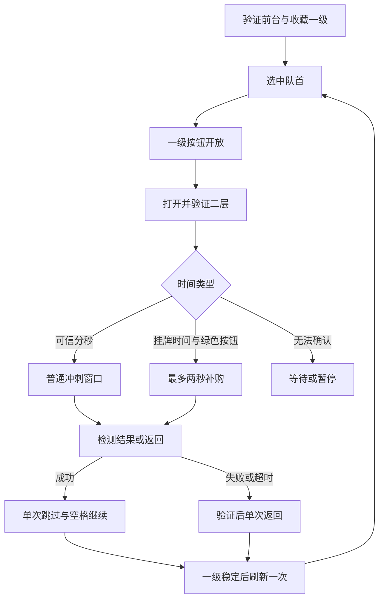

# 开发说明

## 环境与构建

- Windows x64，.NET 8 SDK；运行时使用 Windows WinForms、GDI 和 Win32 API。
- `global.json` 限定 .NET 8，并允许选择已安装的较新 .NET 8 feature band。
- 本项目没有额外的 NuGet PackageReference；首次构建仍可能下载 .NET SDK 的目标包与运行时包。

在仓库根目录运行：

```powershell
.\tools\Build.ps1
.\tools\Build.ps1 -Publish
```

第一条构建整个解决方案并执行仓库内可重复的回归测试；第二条还会发布 Windows x64 单文件程序，位置为 `artifacts/publish/win-x64/v<版本>/`。构建不会启动游戏或发送购买输入。

## 目录与职责

| 位置 | 作用 |
| --- | --- |
| `src/DeltaMarketAssistant/` | 主窗口、校准、样本录入、图标与程序入口 |
| `src/DeltaMarketAssistant.Core/AutomationEngine.cs` | 串联观察、判断、输入和返回流程 |
| `ScreenCapture.cs` / `WindowService.cs` / `NativeMethods.cs` | 客户区边界、DPI、区域截图、Windows API 声明 |
| `VisualAnalyzer.cs` / `VisualDetector.cs` | 颜色比例、细节、图像指纹和画面判定 |
| `CountdownReader.cs` / `CountdownTracker.cs` | 本地字符识别、可信读数和本轮时间窗口 |
| `ResultVisualDetector.cs` | 结果文字、成功特征、返回提示和挂牌时间匹配 |
| `PurchaseFlowGuards.cs` / `SuccessReturnGuard.cs` | 点击间隔、两秒补购、单次 Esc/刷新/跳过/空格保护 |
| `TimingOptions.cs` / `ConfigurationStore.cs` | 参数范围、配置读写、版本升级与运行快照 |
| `tests/DeltaMarketAssistant.Tests/` | 自带断言的控制台测试程序；不是 xUnit 项目 |
| `countdown-samples/` | 三张局部倒计时样本，不包含完整个人游戏画面 |
| `tools/` | 构建、图标生成、模板生成和局部样本导出脚本 |

## 主流程



程序读取桌面图像与窗口元数据，不读取游戏内存、游戏文件或游戏网络请求。识别循环主要捕捉局部区域，预览和异常诊断按需捕捉完整客户区。图片对象使用 `Dispose` 释放；异常诊断保存在用户配置目录。

## 时间和输入约束

普通倒计时首次进入点击阶段后锁定结束时点，避免在零秒切换时重新等待。两秒补购是独立且只开始一次的窗口，不允许普通冲刺结束后追加另一轮补购。每次只发送一个点击，间隔从实际发送完成时重新计算，卡顿后不补发积压输入。

两秒补购只允许本轮打开且经过验证的二层。每次提交仍须确认原标题、绿色按钮和前台窗口；结果或原二层消失即锁定停止。返回需连续验证与发送前复核，最多单次 Esc，一级已出现则不再 Esc。

## 配置和资源

运行配置位于 `%LocalAppData%/DeltaMarketAssistant/config.json`，日志和诊断也位于这个目录。仓库不保存用户配置；换电脑后应重新选择窗口并校准。当前应用版本为 `1.20.0`，配置 schema 为 `11`，二者用途不同。

`Core/Assets` 中的 PNG 是内嵌识别模板。`Assets/icon-source.jpg` 是用户提供的图标原图，相关 PNG 和 ICO 是派生资源。它们随工程保存，不代表对第三方图像拥有再许可权；本次整理没有自动添加开源许可证。

## 推荐阅读顺序

先读 `NormalizedRect` 和 `VisualAnalyzer`，再读 `CountdownReader`、`CountdownTracker` 与保护类，最后阅读 `AutomationEngine` 和 `MainForm`。修改输入条件前先在局部样本或模拟窗口验证，并参照[测试说明](TESTING.md)与[版本管理](VERSIONING.md)。
